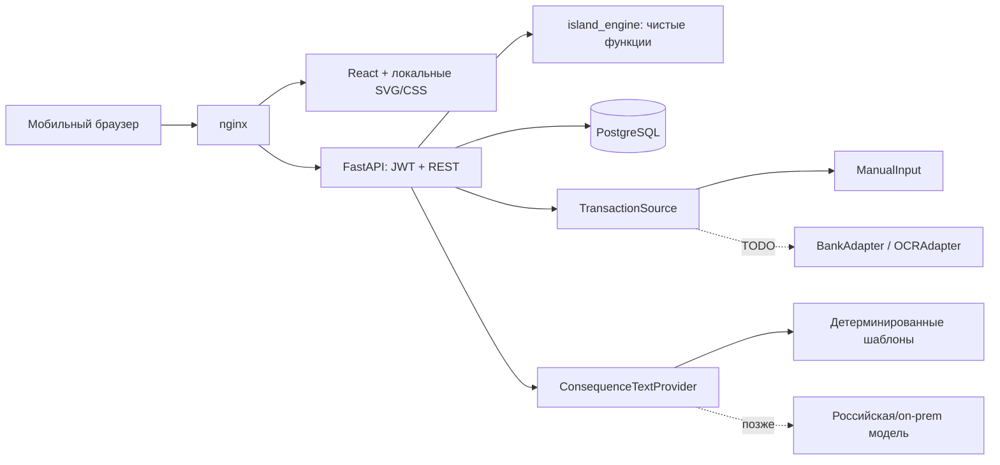

# Остров Денег — MVP BerlogaTeam

Мобильное веб-приложение для возраста 14–22 лет: пользователь задаёт месячный план, одной записью фиксирует траты, сбережения и покупку, от которой воздержался, наблюдает изменения SVG-острова, проходит до четырёх ситуаций в день и видит острова принятых друзей без их финансовых данных.

## Скачать и протестировать с GitHub без Docker

1. На странице репозитория нажмите **Code → Download ZIP** и распакуйте архив полностью.
2. Установите **Python 3.12 или новее**. На Windows при установке включите Python Launcher (`py`). Node.js, PostgreSQL и Docker для этого способа не нужны.
3. На Windows запустите `start-demo.bat` двойным щелчком. На Linux/macOS выполните `sh start-demo.sh` из папки проекта.
4. Откроется `http://127.0.0.1:8080/`. Оставьте окно запуска открытым во время тестирования; для остановки нажмите Ctrl+C.

При первом запуске скрипт создаст `.venv`, загрузит закреплённые Python-пакеты, создаст SQLite-базу `.local-data/island.sqlite3`, выполнит миграции и запустит API вместе с готовым интерфейсом из `demo-web/`. Для **первой установки пакетов нужен интернет**; после неё локальный запуск работает без сети. Данные и секрет остаются на компьютере и не попадают в GitHub. Если порт 8080 занят, запустите `start-demo.bat --port 8081` из терминала либо `python run_demo.py --port 8081`.

Если после перехода на новую распакованную копию в журнале однажды появится `GET /api/auth/me 401 Unauthorized`, браузер отправил вход от прежнего запуска. Приложение удалит устаревший токен и предложит войти снова или создать новый остров. Это штатный отказ в доступе, сервер продолжает работать; данные прежней копии остаются в её собственной папке `.local-data`.
Чтобы сохранить аккаунты и записи при обновлении ZIP, остановите приложение и скопируйте **всю** папку `.local-data` из старой копии в новую до запуска. В ней находятся база и секрет входа; никогда не загружайте её на GitHub.

Чтобы открыть тест на телефоне в той же Wi-Fi-сети, запустите `start-demo.bat --lan` (Linux/macOS: `sh start-demo.sh --lan`), узнайте IPv4-адрес компьютера и откройте `http://АДРЕС:8080/`. При необходимости разрешите порт 8080 в брандмауэре только для частной сети. Это **локальный демонстрационный режим с SQLite**. Не размещайте его в публичном интернете и не вводите реальные персональные данные.

## Основной запуск с PostgreSQL

Нужны Docker и Docker Compose. Из корня репозитория:

```bash
cp .env.example .env
docker compose up --build
curl http://localhost:8080/api/health
```

Откройте `http://localhost:8080`. На Windows вместо `cp` используйте `Copy-Item .env.example .env`; третью команду можно заменить открытием адреса в браузере. После первой сборки достаточно **`docker compose up`**. Для подготовки полностью закрытого контура заранее соберите образы, перенесите их через `docker save` / `docker load` и установите локально: работающие контейнеры не запрашивают внешние сервисы. Начальная сборка из исходников требует доступных базовых образов и пакетов Python/npm; для развёртывания без интернета нужен внутренний registry или предварительно загруженные образы.

## Выложить исходники на GitHub

Создайте на GitHub **пустой репозиторий** (без автоматического README). В терминале в папке проекта выполните, заменив `USERNAME` на свой аккаунт:

```bash
git init
git branch -M main
git add .
git commit -m "Остров Денег MVP"
git remote add origin https://github.com/USERNAME/ostrov-deneg.git
git push -u origin main
```

Если Git сообщает `nothing to commit`, продолжайте со следующей командой. После публикации другой человек скачает ZIP и выполнит шаги раздела «Скачать и протестировать». Перед отправкой проверьте `git status`: `.env`, `.venv`, `.local-data` и `node_modules` исключены правилами `.gitignore`. **GitHub Pages не запускает Python API и базу данных**, поэтому приложение нужно запускать на компьютере или сервере; ссылка на репозиторий сама по себе не является ссылкой на работающую игру.

При первом входе выберите короткое обучение или сразу перейдите к настройке бюджета. Для демонстрации нажмите «Заполнить демо-данными»: появятся записи и принятый демо-друг `ОстровДруг`. Следующая ситуация открывается кнопкой на экране «Ситуации» после выбора; после четвёртой за день экран показывает отсчёт до полуночи по времени Москвы.

## Структура

```text
frontend/              React, TypeScript, Vite, Zustand, SVG-остров
demo-web/              готовая сборка для запуска без Node.js
backend/app/           FastAPI, модели, API, сиды, источники операций
backend/app/island_engine/  чистые формулы
backend/alembic/       миграция PostgreSQL
backend/tests/         тесты правил и API
docker/                nginx-конфигурация
docs/                  API, схема данных, проверки
docker-compose.yml
.env.example
run_demo.py, start-demo.bat, start-demo.sh
```

## Архитектура



Backend не хранит состояние сессии в памяти. JWT передаётся с каждым запросом. Для масштабирования можно поднять несколько экземпляров API за балансировщиком, вынести частые чтения в Redis, добавить очередь для пересчёта снимков и мониторинг OpenTelemetry/Prometheus. PostgreSQL остаётся источником истины. Перед промышленной эксплуатацией нужны ограничения запросов, резервные копии, секреты из защищённого хранилища, HTTPS, аудит доступа и подтверждённое согласие родителя.

Для скачанного демо скрипт запускает тот же FastAPI, который раздаёт заранее собранные файлы `demo-web/`, и заменяет PostgreSQL локальной SQLite-базой. Изменения исходников фронтенда требуют пересборки `frontend` и обновления `demo-web/`; обычному тестировщику это не требуется.

## Игровые правила

Формулы и тесты — в `backend/app/island_engine/engine.py`. Все суммы хранятся целыми копейками. За месяц считаются необходимые `N`, желаемые `W` и сбережения `S`; свободный остаток `B−N−W−S`. Отказ от покупки не уменьшает остаток. Серия записей ограничена семью днями; после одного дня без записи начинается мягкая деградация. Доля желаемого свыше 35% снижает чистоту. Пополнение сбережений, регулярность и отказ от импульсивной покупки улучшают остров. Перерасход влияет на все три показателя. Значения ограничены 0–100; индекс = `0,4×процветание + 0,3×чистота + 0,3×инфраструктура`. Пороги уровней: 0, 40, 55, 70, 78. Сценарии меняют только игровые показатели — это тренировка выбора, не запись реальной операции. Совокупный эффект сценариев за месяц ограничен диапазоном ±12 для каждого показателя, чтобы частые прохождения не вытесняли влияние реальных записей.

Каждый отрицательный эффект обратим. Экран «Почему так?» показывает причину и, если требуется, простой следующий шаг. Финансовый центр открывается на пятом уровне.

Отдельная шкала сбережений открывает видимые детали карты при достижении 5%, 15% и 30% месячного бюджета: сад, теплицу и маяк. Показывается только ближайшая цель. Шкала запаса плана считает `B−N−W−S`: после исчерпания бюджета новая трата запускает штраф за перерасход. Желаемое может снизить чистоту раньше, поэтому интерфейс сообщает об этом отдельно. После общей записи API формирует отчёт с изменениями четырёх показателей по каждому действию; отчёт сохраняется и доступен после обновления страницы.

## Данные, приватность и условия организатора

- Свободный стек: React, FastAPI, PostgreSQL, nginx, Docker. Нет Supabase, Firebase, банковских API, платежей, KYC, внешней аналитики, CDN и удалённых шрифтов.
- Данные предназначены для хранения на сервере в РФ. Выбор российского дата-центра и договорные/организационные меры выполняются при развёртывании команды; код сам по себе не подтверждает полное соответствие 152-ФЗ.
- Регистрация запрашивает только никнейм, один контакт, пароль и год рождения. Пароль хранится как Argon2-хеш. Для года, в котором пользователю может быть меньше 18, показывается текст согласия родителя и фиксируется чекбокс. Это демонстрационная механика, **не подтверждённое согласие**.
- Друг получает только никнейм, показатели, уровень, здания, погоду и индекс. Контакт, возраст, суммы, записи, тексты причин и согласие исключены из публичного DTO. Дружбу должен принять адресат; исключение — системный демо-друг.
- `TransactionSource` отделяет ручной ввод от будущего импорта. `BankAdapter` и `OCRAdapter` — явные заглушки. `ConsequenceTextProvider` позволяет подключить российскую или локальную модель; сейчас используются фиксированные тексты.

## Ограничения MVP

Возраст определяется только по году, поэтому граничные случаи трактуются осторожно. Доступен один бюджет на текущий месяц и ввод операций за текущий месяц. Одна общая запись может включать все три действия с общей датой и заметкой. Ситуаций не более четырёх за календарный день по времени Москвы; выбор пятой блокируется сервером. Снимок острова сохраняется на день, а не на каждое действие. Демо-режим включён по умолчанию для хакатона; для другого окружения установите `DEMO_MODE=false`, задайте собственные `JWT_SECRET` и `POSTGRES_PASSWORD`. Демо-друг с тестовым паролем создаётся только при включённом демо-режиме; не используйте это окружение для настоящих персональных данных.

## Проверки

```bash
cd backend && python -m pytest -q
cd frontend && npm install && npm run build
```

Описание запросов и примеры ответов: [docs/api.md](docs/api.md). Схема таблиц: [docs/data-model.md](docs/data-model.md). Результаты проверок: [docs/test-report.md](docs/test-report.md).
